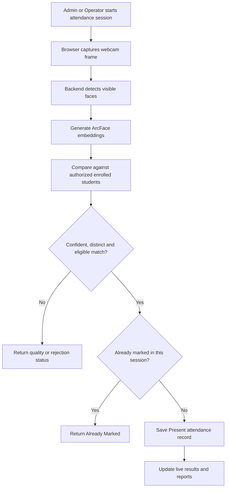

# FDAS — Face Detection Attendance System

**A local, AI-assisted student attendance management system with multi-face recognition.**

FDAS is a Final Year Project that helps authorized university staff enroll students, recognize registered faces through a webcam, record attendance, and generate reports. It combines a React frontend, a Python FastAPI backend, and a local SQLite database with pretrained InsightFace models.

> **Project status:** Local/offline prototype. This repository contains application source code, not a hosted attendance service. The current default **Fast Multi-Face Mode does not perform liveness verification**; photographs or replayed videos may be accepted.

## Features

- **Fast multi-face attendance:** detect multiple faces in one camera frame, match eligible enrolled students independently, and mark attendance per student.
- **Visual recognition feedback:** bounding boxes and distinct states for marked, already marked, image-quality problems, and rejected matches.
- **Student enrollment:** capture and validate a batch of 25 face images, generate facial embeddings, and support deep-enrollment recovery.
- **Role-based access:** Admin and approved Operator accounts, with backend-enforced department restrictions.
- **Attendance sessions:** start and close sessions, prevent duplicate attendance, and retain session records.
- **Student management:** student records, classes, departments, and validated CSV import.
- **Reports:** filtered attendance summaries, CSV export, and printable reports.
- **Account management:** authentication, password recovery, and notifications.
- **Diagnostics:** dedicated recognition checks without writing attendance records.
- **Reversible security mode:** the earlier single-face liveness workflow is retained as an optional backend configuration.

## Technology stack

| Layer | Technologies |
|---|---|
| Frontend | React 19, Vite, React Router, Axios, CSS / utility styling |
| Backend | Python, FastAPI, Pydantic, SQLAlchemy 2 |
| Database | SQLite |
| Face detection | InsightFace `buffalo_l` / SCRFD; OpenCV for protected legacy/enrollment paths |
| Face recognition | Pretrained ArcFace, NumPy, ONNX Runtime |
| Authentication | JWT bearer tokens; PBKDF2-HMAC-SHA256 password hashing |

**Model disclosure:** FDAS integrates a **pretrained** face-recognition model. It does not train ArcFace from scratch.

## How it works



The deep-recognition policy currently uses a **0.85 similarity threshold** and a **0.07 distinct-identity margin**. These are matching criteria, **not accuracy percentages**. The backend also enforces session, eligibility, department, and duplicate checks.

## Repository structure

This repository's application lives inside `fdas-app/`.

```text
FDAS Project/
├── fdas-app/
│   ├── frontend/
│   │   ├── src/
│   │   │   ├── pages/          # Login, Admin and Operator screens
│   │   │   ├── components/     # Camera, overlays, forms, reports
│   │   │   ├── api/            # Axios API wrappers
│   │   │   ├── context/        # Authentication and shared state
│   │   │   ├── layouts/        # Role-specific navigation
│   │   │   └── utils/          # Browser utilities / face tracking
│   │   └── package.json
│   ├── backend/
│   │   ├── app/
│   │   │   ├── main.py         # FastAPI entry point
│   │   │   ├── config.py       # Application configuration
│   │   │   ├── database.py     # SQLite / SQLAlchemy setup
│   │   │   ├── routers/        # HTTP API endpoints
│   │   │   ├── services/       # Recognition and business logic
│   │   │   ├── models/         # SQLAlchemy table models
│   │   │   └── schemas/        # Request / response models
│   │   ├── requirements.txt
│   │   └── .env.example        # Example configuration, no secrets
│   └── docs/
│       ├── FDAS_Complete_Codebase_Structure_and_Viva_Guide.md
│       └── FDAS_Codebase_Cleanup_Report.md
├── references/
└── planning/
```

For the full file-by-file explanation, see the [Codebase Structure and Viva Guide](fdas-app/docs/FDAS_Complete_Codebase_Structure_and_Viva_Guide.md).

## Local setup

### Prerequisites

- Windows or another compatible desktop environment
- Python compatible with the backend dependencies (the project has been developed with Python 3.11)
- Node.js and npm
- Webcam
- Local InsightFace `buffalo_l` model assets available to the backend

> The repository intentionally does **not** include production databases, face images, biometric embeddings, private credentials, or large pretrained model weights. The application requires local configuration and model provisioning before face recognition can work. Consult the backend's model provisioning scripts and configuration for the exact expected paths.

### 1. Clone the repository

```powershell
git clone https://github.com/Ahmad-mugal/FDAS-Face-Attendance-System.git
cd FDAS-Face-Attendance-System
```

### 2. Start the backend

Open a PowerShell terminal:

```powershell
cd fdas-app/backend
py -3.11 -m venv .venv
.\.venv\Scripts\Activate.ps1
python -m pip install -r requirements.txt
```

Review `backend/.env.example` and create your own private `.env` with appropriate local settings. Do **not** commit `.env` or real credentials.

Once required configuration and model assets are available:

```powershell
python -m uvicorn app.main:app --host 127.0.0.1 --port 8000
```

API documentation (when backend is running): `http://127.0.0.1:8000/docs`

### 3. Start the frontend

Open a **second** PowerShell terminal from the repository root:

```powershell
cd fdas-app/frontend
npm ci
npm run dev
```

Open: **http://127.0.0.1:5173**

The browser must be allowed to access the webcam. Use locally provisioned, authorized accounts; do not rely on publicly shared demo credentials.

## Attendance modes

| Mode | Behavior |
|---|---|
| `FAST_MULTI_FACE` (default) | Processes multiple faces; no mandatory liveness check |
| `SECURE_SINGLE_FACE` | Retains the original single-face movement challenge and additional recognition checks |

To select a mode, set the backend environment variable and **restart the backend**:

```env
FDAS_ATTENDANCE_MODE=FAST_MULTI_FACE
```

or

```env
FDAS_ATTENDANCE_MODE=SECURE_SINGLE_FACE
```

The secure workflow is retained for reversibility. **Neither mode should be described as a certified anti-spoofing solution.**

## Important source files

| What to find | Path within `fdas-app/` |
|---|---|
| Application routes | `frontend/src/App.jsx` |
| Login page | `frontend/src/pages/LoginPage.jsx` |
| Live attendance camera and scanning | `frontend/src/components/LiveAttendanceStation.jsx` |
| Face bounding-box overlay | `frontend/src/components/FaceOverlay.jsx` |
| Face tracking | `frontend/src/utils/faceTracking.js` |
| Enrollment capture | `frontend/src/components/AutoFaceEnrollmentCapture.jsx` |
| Frontend API client | `frontend/src/api/client.js` |
| FastAPI application | `backend/app/main.py` |
| Attendance API | `backend/app/routers/attendance_marking.py` |
| Face encoding | `backend/app/services/deep_face.py` |
| ArcFace matching | `backend/app/services/deep_face_matching.py` |
| Attendance persistence | `backend/app/services/attendance_marking.py` |
| Database connection | `backend/app/database.py` |
| Attendance record model | `backend/app/models/attendance_record.py` |

See the [complete navigation guide](fdas-app/docs/FDAS_Complete_Codebase_Structure_and_Viva_Guide.md) for function names, API endpoints, workflows, and technical viva questions.

## Security and privacy

- Do not upload real student face images, embeddings, attendance databases, or backups.
- Keep `.env` files, JWT secrets, SMTP credentials, and reset tokens private.
- Protect access to student records and biometric data; use test/synthetic data for demonstrations.
- Review **Git history**, not just the latest commit, before making the repository public.
- Fast Mode prioritizes speed and convenience over spoof resistance; photos and video replays are a known risk.
- This is an academic prototype, not a certified biometric security or large-scale production deployment.

## Testing

The project includes backend verification scripts and frontend unit/smoke tests. Run the relevant checks in a safe development environment with disposable test data. Do not run mutation-capable test suites against a production SQLite database.

Actual recognition performance depends on lighting, camera quality, CPU hardware, enrollment quality, and the number of faces. No general accuracy or latency guarantee is claimed here.

## Project documentation

- [Codebase Structure and Viva Guide](fdas-app/docs/FDAS_Complete_Codebase_Structure_and_Viva_Guide.md)
- [Codebase Cleanup Report](fdas-app/docs/FDAS_Codebase_Cleanup_Report.md)
- [Development Journey](fdas-app/docs/development_journey.md)

## Project information

**Project:** FDAS — Face Detection Attendance System  
**Type:** University Final Year Project  
**Primary focus:** Computer vision, face recognition, attendance automation, and full-stack development  
**GitHub:** [Ahmad-mugal/FDAS-Face-Attendance-System](https://github.com/Ahmad-mugal/FDAS-Face-Attendance-System)

---

*This README describes the implemented local prototype. Configuration, dependencies, and supported workflows should be verified against the current source code when deploying or modifying the project.*
